# Студия от темы до MP4: полный цикл, подробно

Документ для владельца студии (не для YouTube): как сейчас устроена работа — от идеи темы до готового файла, что
происходит внутри каждой команды, какие файлы появляются, какие временные и когда удаляются, что остаётся на диске
после финального рендера. В конце — что уже сделано, кратко roadmap, шпаргалка и раскладка в слайды для презентации.

Состояние на 2026-10-23, `master` = `b6d5686` (этапы 0–5 `REFACTOR_PLAN.md` закрыты). Цифры и пороги взяты из кода
`studio/`, а не по памяти; если код поменяется — сверяйте с `docs/ARCHITECTURE.md` и `docs/PHASES.md`.

---

## Содержание
1. [Студия в одной картинке](#1-студия-в-одной-картинке)
2. [Кто что делает: ты, Claude, движок](#2-кто-что-делает-ты-claude-движок)
3. [Карта репозитория](#3-карта-репозитория)
4. [Анатомия проекта `projects/<slug>/`](#4-анатомия-проекта-projectsslug)
5. [Полный цикл: обзор](#5-полный-цикл-обзор)
6. [Этап А. Недельный цикл канала: радар → бриф](#6-этап-а-недельный-цикл-канала-радар--бриф)
7. [Фаза 0. Окружение](#7-фаза-0-окружение)
8. [Фаза 1. Бриф → `project.yaml` (+ демо стиля)](#8-фаза-1-бриф--projectyaml--демо-стиля)
9. [Фаза 2. План → `outline.md`](#9-фаза-2-план--outlinemd)
10. [Фаза 3. Сценарий → `script/chNN.yaml` + `validate`](#10-фаза-3-сценарий--scriptchnnyaml--validate)
11. [Фаза 4. Озвучка и тайминг — `voice`](#11-фаза-4-озвучка-и-тайминг--voice)
12. [Фаза 5. Контрольные кадры — `stills`](#12-фаза-5-контрольные-кадры--stills)
13. [Фаза 6. Рендер сцен — `render`](#13-фаза-6-рендер-сцен--render)
14. [Фаза 7. Сборка — `assemble` (звук и склейка)](#14-фаза-7-сборка--assemble-звук-и-склейка)
15. [Фаза 8. Проверка — `qa`](#15-фаза-8-проверка--qa)
16. [После финального рендера: что лежит, что удаляется, `clean`](#16-после-финального-рендера-что-лежит-что-удаляется-clean)
17. [Временные файлы: полная таблица жизни](#17-временные-файлы-полная-таблица-жизни)
18. [Кэши: что пересчитывается при правке](#18-кэши-что-пересчитывается-при-правке)
19. [Длинный ролик (30–60 минут)](#19-длинный-ролик-3060-минут)
20. [Логи, статус, диагностика](#20-логи-статус-диагностика)
21. [Как студия проверяет сама себя](#21-как-студия-проверяет-сама-себя)
22. [Что уже сделано](#22-что-уже-сделано)
23. [Roadmap кратко](#23-roadmap-кратко)
24. [Шпаргалка команд](#24-шпаргалка-команд)
25. [Приложение: раскладка в слайды](#25-приложение-раскладка-в-слайды)

---

## 1. Студия в одной картинке

**Тема → готовый MP4** с озвучкой, анимацией (всё нарисовано кодом: Python + Pillow, без стоков и видеоредакторов),
субтитрами, музыкой и автоматической проверкой.

```
тема ─► project.yaml ─► outline.md ─► script/chNN.yaml ─► [voice] ─► build/timeline.json
                                                            │            │
                                                     build/tts/*.wav     ├─► [stills] ─► qa/stills_*.png
                                                     (кэш по тексту)     ├─► [render] ─► build/render/chNN/sNN.mp4 (кэш по сцене)
                                                                         └─► [assemble] ─► build/mix/levels.json
                                                                                               └─► build/final/<slug>.mp4 + .srt/.vtt
                                                                                                        └─► [qa] ─► qa/report.md + 2 листа PNG
```

Принципы, на которых всё держится:

| Принцип | Что это значит на практике |
|---|---|
| **Состояние в файлах, а не в памяти** | Что готово — вычисляется из файлов (`python -m studio status`). Новая сессия Claude продолжает с того же места. |
| **Сначала дёшево, потом дорого** | `validate` (мгновенно) → `stills` (секунды, без кодирования видео) → `render --draft` (полразмера) → чистовой `render`. |
| **Кэш на каждом шаге** | Озвучка кэшируется по строке, рендер — по сцене. Правка одной фразы перерисовывает только то, что реально изменилось. |
| **Бесшовность** | Одно глобальное время, состояние через стыки (`state`), один звук на весь ролик, один кодек — склейки не видно. |
| **Платное — только после «да»** | ElevenLabs не синтезирует без `--yes`; перед этим печатается, сколько символов уйдёт. |
| **Честность** | Нет голоса — стоп (ролик «только с субтитрами» не делаем). Речь не обрезаем и не ускоряем за `rate_range`. |

---

## 2. Кто что делает: ты, Claude, движок

| Кто | Роль | Чем управляется |
|---|---|---|
| **Ты** | выбираешь тему, утверждаешь демо стиля, смотришь итог, даёшь «да» на платный синтез и на push | чат с Claude |
| **Claude (Claude Code)** | пишет бриф, план, сценарии, запускает команды, смотрит PNG-листы, чинит входы | `CLAUDE.md` (правила), слэш-команды `.claude/commands/*.md`, документы `docs/` |
| **Движок `python -m studio`** | детерминированно делает озвучку, тайминг, кадры, видео, микс, проверки | `studio/` (Python), входы проекта (`project.yaml`, `script/*.yaml`, `templates/*.py`) |
| **Внешние программы** | ffmpeg/ffprobe (кодирование, звук, проверки), голос (ElevenLabs / edge / RHVoice / piper) | вызываются движком |

Слэш-команды (скиллы) Claude — это готовые сценарии работы:

| Команда | Что делает | Где описана |
|---|---|---|
| `/topic-radar [фокус]` | ищет 10 тем недели с источниками и вердиктом → `studios/notes-from-the-mind/research/radar/<ГГГГ-Wнн>.md` | `.claude/commands/topic-radar.md` |
| `/topic-to-brief N` | тема N из радара → полный бриф `studios/notes-from-the-mind/briefs/<имя>.md` | `.claude/commands/topic-to-brief.md` |
| `/new-video <тема или бриф>` | бриф → план → (короткий ролик) сразу MP4; длинный — первая глава | `.claude/commands/new-video.md` |
| `/next [slug]` | один следующий законченный шаг проекта (следующая глава / рендер / сборка) | `.claude/commands/next.md` |
| `/chapter <slug> chNN [что]` | написать или переписать одну главу до отрендеренной | `.claude/commands/chapter.md` |
| `/qa [slug]` | собрать, проверить, отдать | `.claude/commands/qa.md` |
| `/roadmap [задача]` | следующая задача развития студии (ветки `stage-N`, тесты, отметка в плане) | `.claude/commands/roadmap.md` |

---

## 3. Карта репозитория

```
video-studio/
├─ CLAUDE.md                 правила для Claude (читается автоматически каждую сессию)
├─ START_HERE.md, README.md  вход для человека
├─ .env                      секреты: ELEVENLABS_API_KEY, ELEVENLABS_VOICE_ID (в .gitignore; образец .env.example)
├─ pyproject.toml            зависимости с точными версиями (numpy, Pillow, PyYAML) — от версии Pillow зависят пиксели
├─ studio/                   ДВИЖОК
│  ├─ cli.py                 разбор `python -m studio <команда>`
│  ├─ commands/<команда>.py  по модулю на команду (doctor, new, validate, voice, stills, render, assemble, qa, all,
│  │                         status, templates, frame, demo, selftest, clean)
│  ├─ config.py              схема project.yaml: ключи, типы, умолчания, миграция версий
│  ├─ project.py, workspace.py   загрузка проекта; где лежат данные и студии (studios/, projects/, .env, logs/)
│  ├─ tts.py                 голоса и кэш озвучки
│  ├─ timing.py              раскладка по времени → timeline.json
│  ├─ calibration.py         замер реального темпа голоса
│  ├─ subs.py                нарезка субтитров, SRT/VTT
│  ├─ render.py              кадры → mp4 по сценам, stills, кэш
│  ├─ codehash.py            хэш кода шаблона для ключа рендера
│  ├─ audio.py, sfx.py       голос по таймлайну, музыка, звуки появления, микс, громкость
│  ├─ assemble.py            склейка финала
│  ├─ qa.py, safezone.py     автопроверки и листы кадров
│  ├─ status.py, clean.py, log.py, selftest.py
│  ├─ style.py, gfx.py, anim.py, motion.py    стиль, рисование, кривые, тайминги движения
│  └─ packs/                 ШАБЛОНЫ СЦЕН: core/ (title, statement…), phone/, lab/ (стиль канала), commerce/
├─ projects/                 РОЛИКИ студии default; _template/ — заготовка для `new` (общая для всех студий)
├─ studios/<id>/             СТУДИИ (ROADMAP A1): studio.yaml, CLAUDE.md, свои channel/ briefs/ research/ projects/
│  └─ notes-from-the-mind/   канал Notes From The Mind:
│     ├─ channel/            POSITIONING.md (закон тем), STYLE.md (визуал), style-demo.html (эталон движения),
│     │                      topics-log.md, visuals-log.md, README.md
│     ├─ briefs/             брифы роликов; _TEMPLATE.md — шаблон из 11 разделов
│     ├─ research/radar/     отчёты радара по неделям
│     └─ projects/           ролики канала (fake-discounts — живой эталон)
├─ scripts/                  weekly-radar.ps1 / .sh — автозапуск радара
├─ docs/                     PHASES, ARCHITECTURE, SCENE_SPEC, TTS, LESSONS, AUDIT, REFACTOR_PLAN, ROADMAP, history/
├─ tests/                    ~40 файлов pytest, fixtures/gallery (все шаблоны), golden/ (эталоны)
├─ assets/fonts/             Manrope, Unbounded, JetBrains Mono (OFL) — шрифты стиля lab
├─ tools/                    setup_rhvoice.sh, bench.py, голоса piper (бинарники — не в git)
├─ logs/                     логи команд без проекта и радара (не в git)
└─ .github/workflows/ci.yml  CI: ruff, pytest, selftest на Ubuntu и Windows
```

**В git** — только входы: код, документы, `project.yaml`, `outline.md`, `script/*.yaml`, `templates/*.py` проектов.
**Не в git** (`.gitignore`) — всё пересобираемое и секретное: `projects/*/build/`, `projects/*/qa/`, `logs/`,
`projects/*-demo/`, `projects/regress*/`, `output/`, `.env`, `tools/rhvoice/`, `tools/piper-voices/`.

---

## 4. Анатомия проекта `projects/<slug>/`

```
projects/<slug>/
├─ project.yaml              ВХОД. Бриф: язык, формат, голос, стиль, музыка, субтитры, громкость, порядок глав
├─ outline.md                ВХОД. План: идея, главы с бюджетом слов, визуальная линия, сквозные решения
├─ script/ch01.yaml …        ВХОД. Сценарий главы: сцены, текст диктора, шаблон и параметры сцены
├─ templates/*.py            ВХОД (необязательно). Свои шаблоны сцен проекта (пространство имён project.*)
├─ demo/ch01.yaml            ВХОД (канал). Сценарий демо стиля 10–15 с
│
├─ build/                    ГЕНЕРИРУЕТСЯ (не в git)
│  ├─ tts/<16hex>.wav        озвучка строки: 48 кГц моно 16 бит, тишина по краям срезана
│  ├─ tts/<16hex>.words.json таймкоды слов строки (ElevenLabs/edge — настоящие; fake — свои)
│  ├─ timeline.json          раскладка всего ролика: сцены, кадры, строки, биты, слова, субтитры
│  ├─ voice_calibration.json замер темпа голоса (слов/мин)
│  ├─ render/chNN/sNN.mp4    видео сцены (+ sNN.mp4.key — ключ кэша)
│  ├─ render/chNN/parts/     куски длинных сцен во время рендера (потом удаляются)
│  ├─ render-draft/          то же для чернового рендера (полразмера)
│  ├─ chapters/chNN.mp4      файлы глав — только с `assemble --chapters`
│  ├─ mix/music_loop.wav     процедурная музыкальная петля 32 с (кэш)
│  ├─ mix/levels.json        громкость голоса и музыки (LUFS) для qa
│  └─ final/<slug>.mp4 .srt .vtt    РЕЗУЛЬТАТ (+ <slug>.draft.mp4 у черновика)
│
├─ qa/                       ГЕНЕРИРУЕТСЯ: stills_*.png, frame_*.png, report.md, subs_check.png, final_frames.png
└─ logs/                     ГЕНЕРИРУЕТСЯ: <команда>-<ГГГГММДД-ЧЧММСС>.log, по 20 последних на команду
```

`status` смотрит именно на эти файлы: нет `timeline.json` или его хэш не совпадает с входами — фаза 4 не готова и т. д.

---

## 5. Полный цикл: обзор

```mermaid
flowchart LR
  R["/topic-radar<br/>studios/notes-from-the-mind/research/radar/*.md"] --> B["/topic-to-brief N<br/>studios/notes-from-the-mind/briefs/*.md"]
  B --> NV["/new-video brief"]
  NV --> P1["Ф1 project.yaml<br/>+ демо стиля"]
  P1 --> P2["Ф2 outline.md"]
  P2 --> P3["Ф3 script/chNN.yaml<br/>validate"]
  P3 --> P4["Ф4 voice<br/>tts + timeline"]
  P4 --> P5["Ф5 stills<br/>смотреть PNG"]
  P5 -->|правки| P3
  P5 --> P6["Ф6 render<br/>в фоне"]
  P6 --> P7["Ф7 assemble<br/>микс + склейка"]
  P7 --> P8["Ф8 qa<br/>все ✅"]
  P8 --> D["Сдача: MP4 + .srt"]
  D --> PUB["Публикация вручную<br/>topics-log: published"]
```



| Фаза | Команда | Вход | Выход | Готово, если |
|---|---|---|---|---|
| А | `/topic-radar`, `/topic-to-brief` | POSITIONING.md, topics-log.md | радар, бриф | бриф заполнен, у каждой цифры источник |
| 0 | `doctor` | машина | отчёт | хотя бы один голос «синтез работает» |
| 1 | `new`, `demo` | тема / бриф | `project.yaml`, демо 10–15 с | нет `TODO` в title/topic, главы перечислены, демо утверждено |
| 2 | — (Claude пишет) | бриф | `outline.md` | сумма бюджетов слов ≈ длительность × wpm/60, нет `TODO` |
| 3 | `validate` | `script/chNN.yaml` | отчёт | нет ❌ |
| 4 | `voice [--yes]` | сценарий | `build/tts/`, `timeline.json`, `.srt/.vtt` | текст влез, нет ❌ по триггерам, темп 130–170 слов/мин |
| 5 | `stills` | timeline | `qa/stills_*.png` | на листе нет дефектов (смотрим глазами) |
| 6 | `render` | timeline + шаблоны | `build/render/chNN/sNN.mp4` | `status`: «N/N сцен актуальны» |
| 7 | `assemble` | сцены + озвучка | `build/final/<slug>.mp4` | файл собран |
| 8 | `qa` | финал | `qa/report.md` + 2 PNG | все ✅, оба PNG просмотрены |

Короткий ролик (до ~3 минут) — все фазы за одну сессию (`/new-video`, или `python -m studio all`). Длинный — по главе
за сессию (раздел 19).

---

## 6. Этап А. Недельный цикл канала: радар → бриф

Только для канала Notes From The Mind. Для разового ролика начинаем сразу с фазы 1.

### А.1. Радар тем — `/topic-radar [фокус]`
Запуск вручную в Claude или автоматически по расписанию (А.4).

1. **Читает закон канала:** `studios/notes-from-the-mind/channel/POSITIONING.md` (линза, территория, стоп-лист, фильтр, рубрики, микс, календарь,
   формулы названий) и `studios/notes-from-the-mind/channel/topics-log.md` (что уже было — не повторять; `rejected` — никогда; `mentioned` —
   можно как `DEEP-DIVE`, не больше двух).
2. **Собирает ≥ 30 кандидатов** в интернете по пяти потокам: A — вирусные «факты» (Reddit, тренды), B — свежая наука
   за 14 дней (PsyPost, EurekAlert…), C — провалы репликаций (Retraction Watch, Many Labs), D — спрос (Google Trends,
   подсказки поиска), E — календарь поводов на 2–6 недель вперёд.
3. **Фильтрует:** фильтр из 4 вопросов + стоп-лист. Одно «нет» — тема выброшена.
4. **Проверяет доказательства:** минимум 2 реальных источника на тему (исследование + обзор/репликация); соцсети и
   чужие ролики — только сигнал тренда. Цифры без источника не придумываются.
5. **Оценивает** по 7 критериям с весами (разрыв «верят ↔ нашли» ×3, спрос ×2, доказательства ×2, «узнаю себя» ×2,
   своевременность, визуальность без лица, Shorts-потенциал) — максимум 60.
6. **Собирает 10 тем** с жёстким миксом: ~7 вечнозелёных + ~3 горячих, минимум 2 Myth on Trial, 1 Money Brain,
   1 Fresh Study, 1 календарная.
7. **Пишет отчёт** `studios/notes-from-the-mind/research/radar/<ГГГГ>-W<нн>.md` (по-русски; названия, хуки, вопросы — по-английски). Файл недели
   уже есть — суффикс `-2`, не перезаписывает.
8. **Дописывает 10 строк** в `studios/notes-from-the-mind/channel/topics-log.md` со статусом `radar`.
9. В чате: путь, тема недели, сводка, «Следующий шаг: /topic-to-brief N».

Сухой режим `/topic-radar dry` — 3 темы, файл `…-dry.md`: проверка путей без полного поиска.

### А.2. Бриф — `/topic-to-brief N [путь к радару]`
1. Читает POSITIONING, `studios/notes-from-the-mind/briefs/_TEMPLATE.md`, радар (по умолчанию самый свежий), находит тему N.
2. **Досбор фактов:** 6–12 фактов и ≥ 3 источника (Everyday Brain — 40–80 фактов). Каждая цифра сверяется;
   не подтвердилась — убрать или пометить `(?) уточнить`. Если цифра брифа расходится с первоисточником — берётся
   первоисточник.
3. Структура рубрики (Myth on Trial: хук ≤ 20 с → откуда миф → что нашли проверки → вердикт → почему миф живёт →
   польза для зрителя).
4. **Заполняет шаблон из 11 разделов:** тема и вердикт; язык (en), длительность, формат; зритель; стиль (`lab`,
   шаблоны композиции по частям, визуальная идея: метафора, настроение, новые элементы, открывающая сцена); голос
   (ElevenLabs); структура; содержание с источниками; произношение; начало и конец; призывы (подписка на 35–50 %,
   вопрос для комментариев); названия, превью, источники для описания.
5. Сохраняет `studios/notes-from-the-mind/briefs/<имя>.md`, в `topics-log.md` статус `radar` → `brief`.
6. В чате: «Запуск: /new-video studios/notes-from-the-mind/briefs/<имя>.md».

### А.3. Запуск ролика — `/new-video studios/notes-from-the-mind/briefs/<имя>.md`
Дальше — фазы 0–8 (разделы 7–15).

### А.4. Автозапуск радара (Планировщик заданий Windows)
```
Планировщик (понедельник 09:00)
  └─ powershell scripts/weekly-radar.ps1 [фокус]      находит Git Bash
       └─ bash scripts/weekly-radar.sh                 PYTHONUTF8=1, ищет claude
            └─ claude -p "/topic-radar <фокус>"        без человека; разрешены только WebSearch, WebFetch,
                                                       Read, Write, Edit, Glob, Grep, date, mkdir
                 ├─ studios/notes-from-the-mind/research/radar/<ГГГГ-Wнн>.md
                 └─ logs/radar-<ГГГГ-ММ-ДД>.log
```
Регистрация задачи — команды в шапке `scripts/weekly-radar.ps1`.

### А.5. После публикации
Статус темы в `studios/notes-from-the-mind/channel/topics-log.md` → `published` (или `rejected`); визуальная идея ролика — строка в
`studios/notes-from-the-mind/channel/visuals-log.md` (чтобы следующий ролик не повторял метафору и настроение).

---

## 7. Фаза 0. Окружение

Один раз на машину:
```bash
pip install -r requirements-dev.txt     # numpy, Pillow, PyYAML (точные версии) + pytest, ruff
python -m studio doctor
```
Windows: в окружении `PYTHONUTF8=1`, иначе вывод с кириллицей падает, а piper виснет.

**Что проверяет `doctor`** (по порядку):
1. `ffmpeg`, `ffprobe` в PATH.
2. Python-библиотеки и **совпадение версий с закреплёнными** (`pyproject.toml`): другая версия Pillow = другие
   пиксели → кэш и эталоны «поплывут» (⚠️).
3. Шрифт с кириллицей и латиницей.
4. **Каждый голос реальным синтезом** фразы проверки («Проверка голоса.» / «Voice check.») для ru и en:
   rhvoice, edge, piper. Временная папка проверки создаётся в системном TEMP и сразу удаляется.
5. **ElevenLabs — бесплатно, без синтеза:** запросы `/v1/user` и `/v1/voices/{id}` → имя голоса, тариф,
   остаток символов. Ключ никогда не печатается (даже из ответа API — заменяется на `***`).
6. Ядра CPU и сколько процессов рендера будет по умолчанию (половина логических ядер; на i7-13700 — 12).

**Голоса** (`docs/TTS.md`):

| Бэкенд | Качество | Сеть | Таймкоды слов | Заметки |
|---|---|---|---|---|
| `elevenlabs` | лучшее, голос канала | да, платно | настоящие (из API) | модель `eleven_multilingual_v2` (говорит и по-русски); темп только числом |
| `edge` | очень естественное (Microsoft) | да, бесплатно | настоящие (WordBoundary) | ru: `ru-RU-DmitryNeural`; таймаут 90 с на строку, 1 повтор |
| `rhvoice` | «дикторское» | нет | оценка по слогам | ставится `bash tools/setup_rhvoice.sh` (Linux/macOS) |
| `piper` | нейросеть | нет | оценка по слогам | модели `.onnx` в `tools/piper-voices/` |
| `fake` | тон вместо речи | нет | свои, детерминированные | **только тесты и черновики** |

**Железное правило:** нет ни одного рабочего голоса — сказать пользователю и остановиться. Если голос отвалился
во время работы, команда завершается с кодом 2 и сообщением «Синтез речи недоступен… Ролик без озвучки не делаем».

---

## 8. Фаза 1. Бриф → `project.yaml` (+ демо стиля)

### 8.1. Что делает `python -m studio new "<тема>" [--slug x] [--format …] [--duration N] [--lang ru|en] [--tts …] [--studio id]`
1. **Выбирает голос**, если `--tts` не задан: `elevenlabs` — только если есть ключ в `.env`, язык `en` и это
   студия канала (есть `channel/POSITIONING.md`, т. е. `new --studio notes-from-the-mind`); иначе `edge`, если установлен; иначе `rhvoice`, если
   собран; иначе записывает `rhvoice` с ⚠️ «поставьте голос». *Для русского ролика на ElevenLabs — `--tts elevenlabs` явно.*
   Без `--lang`/`--format` — из `defaults:` в `studio.yaml` студии, иначе `ru`/`vertical`.
2. **Slug**: из `--slug` или транслитом темы (кириллица → латиница, всё лишнее → `-`, до 40 символов).
   Папка уже есть — отказ.
3. **Копирует `projects/_template/`** целиком (project.yaml, outline.md-заготовка, script/, templates/, demo/).
4. **Подставляет** в `project.yaml`: тему (как JSON-строку — безопасно для кавычек и двоеточий), язык, формат,
   длительность, бэкенд голоса. Бэкенд пишется явно: он входит в ключ кэша озвучки и не должен зависеть от машины.

### 8.2. Поля `project.yaml` (схема — `studio/config.py`)

| Ключ | По умолчанию | Смысл |
|---|---|---|
| `title`, `topic`, `audience` | — | название, тема, для кого и что зритель вынесет (`TODO` = фаза 1 не готова) |
| `language` | `ru` | язык озвучки и текстов; задаёт голос по умолчанию, темп `wpm`, проверку «чужого алфавита» |
| `format` | `vertical` | `vertical` 1080×1920 · `horizontal` 1920×1080 · `square` 1080×1080 |
| `fps` | 30 | должен делить 48000 (24/25/30/60) |
| `target_duration` | `null` | точная длительность в секундах (Shorts) или `null` — по речи |
| `tts.backend` / `voice` / `rate` | `rhvoice` / `auto` / 105 | голос; `voice: auto` — по языку, у ElevenLabs — `ELEVENLABS_VOICE_ID` из `.env`; `rate` — 100 = норма |
| `tts.rate_range` | [98, 125] | что считаем естественным темпом; быстрее не ускоряем |
| `tts.model, stability, style, …` | — | настройки ElevenLabs; входят в ключ кэша |
| `pauses.start/comma/sentence/scene/end` | 0.45 / 0.18 / 0.40 / 0.55 / 0.6 с | паузы: начало ролика, после запятой, после точки, между сценами, конец |
| `style.palette` | `neon` | `neon` · `calm` · `lab` (стиль канала) |
| `style.mood`, `overrides` | — | только `lab`: настроение `lab/night/ember/deep/orchid`, свои HEX подсветок и `accent2` |
| `music.enabled / level_db / duck / file` | да / −13 / да / — | подложка; приглушать под голосом; свой файл вместо процедурной |
| `sfx.enabled / level_db` | да / 0 | звуки появления элементов (у шаблонов `lab`) |
| `subtitles.enabled / max_lines / size` | да / 2 / авто | субтитры; авто-кегль = 5,2 % короткой стороны кадра |
| `render.workers / crf / preset` | авто / 18 / `medium` | процессы рендера, качество x264 |
| `loudness` | −16 | цель громкости итога, LUFS (канал: −14) |
| `qa.safe_margin` | 0.04 | поля кадра для проверки «контент у края» (4 % стороны) |
| `chapters` | [] | порядок глав → файлы `script/<id>.yaml` |

При загрузке: неизвестный ключ — ⚠️ с подсказкой ближайшего (`subtitle:` → «может быть, subtitles?»), не тот тип — ⚠️.
`schema_version` — старые файлы без неё поднимаются миграцией в памяти, сам файл не трогается.

### 8.3. Демо стиля (канал) — `python -m studio demo <slug> [--no-render] [--yes]`
Стиль фиксируется **до** сценария и на весь ролик не меняется.
1. Claude пишет `projects/<slug>/demo/ch01.yaml` (2–3 сцены: метафора ролика, настроение, новые элементы, один вердикт).
2. `demo` создаёт отдельный проект `projects/<slug>-demo/` (не в git): копирует настройки проекта (title меняется на
   «style demo: …», `chapters: [ch01]`), сценарий демо и свои шаблоны проекта.
3. Без `--no-render` прогоняет `all`: validate → voice → render → assemble → qa.
4. Проверяет длительность 10–15 с; иначе ⚠️ «поправьте текст».
5. MP4 показывается пользователю — **стоп до утверждения**. После «да» — раздел «Визуальная идея — утверждено» в
   `outline.md` и строка в `studios/notes-from-the-mind/channel/visuals-log.md` со статусом `approved`.

---

## 9. Фаза 2. План → `outline.md`

Пишет Claude, команды нет. Содержание:
- **идея в одном предложении**;
- **таблица глав:** файл, о чём, хронометраж, **бюджет слов** = минуты × `wpm` (ru ~145, en ~155 слов/мин;
  после первой озвучки — реальный замер голоса, ElevenLabs en ≈ 185);
- **призывы:** подписка один раз на ~35–50 % ролика (вплетена в речь), вопрос для комментариев ближе к концу;
- **визуальная линия:** шаблоны, сквозной мотив;
- **сквозные решения** — язык, голос, темп, палитра, термины. Их не меняют между сессиями без пользователя.

Длинный ролик: у каждой главы своя мини-дуга — крючок → суть → вывод → мост к следующей.
`status` считает фазу готовой, когда файл есть и в нём нет `TODO`.

---

## 10. Фаза 3. Сценарий → `script/chNN.yaml` + `validate`

### 10.1. Формат сцены
```yaml
chapter: ch01
title: "Якорь"
glow: night                       # необязательно (lab): свой оттенок подсветки главы, плавный переход на стыке
scenes:
  - id: s01                       # уникален в главе
    template: lab_flow            # шаблон: `python -m studio templates`
    lines:                        # текст диктора; одна строка = одно предложение = один запрос синтеза
      - "Сначала тема. | Потом бриф. | Потом ролик."
      - {text: "Это вердикт.", voice: {style: 0.4}}   # акцент голоса на строку (ElevenLabs)
    params: {...}                 # параметры шаблона
    min_duration: 3               # жёсткий минимум длительности сцены, с
    want_duration: 0              # мягкое желание (получает запас, если есть target_duration)
    hold: 0                       # секунды после речи
    voice: {style: 0.3}           # акцент на всю сцену
```
- **`|` — биты:** точки синхронизации внутри фразы, интонацию не рвут. Шаблоны вешают на биты события (пункт списка,
  карточку), субтитры режутся по битам.
- **`*слово*`** в текстах шаблонов — акцентный цвет; из озвучки и субтитров `*` и `|` убираются.
- **Триггеры `at`** (стиль `lab`): элемент появляется на слове озвучки — `at: "66"`, `"median of"`, `"some#2"`
  (второе вхождение), номер бита `3`, секунды `"1.5s"`. Старт — за 4 кадра до слова.
- **Через склейку** (позиция ленты, шапка `chrome`, перенос цифры `keep: [hero]`, подсветка главы) — только через
  `state`, никогда локальной анимацией: тогда стык невидим.
- Правила текста: сцена 3–12 с, смена картинки каждые ~6–8 с; числа словами, если важно произношение; без чужого
  алфавита (в русском — «ютуб», не YouTube); канал — 1–2 акцента голоса на ролик.

### 10.2. Шаблоны
Пакеты `studio/packs/`: `core` (title, statement, bullets, counter, outro), `phone` (лента в телефоне: feed, lock,
cards, questions, close), `lab` (стиль канала: flow, diagram, versus, crowd, hero_stack, full_number, chapter,
verdict), `commerce` (price_tag, number). Полное имя `пакет.имя` (`lab.flow`), старые имена (`lab_flow`) — алиасы.
Свой шаблон — `projects/<slug>/templates/<имя>.py` по контракту `docs/SCENE_SPEC.md`; удачный общий переносится в пакет.

### 10.3. Что проверяет `validate`
| Проверка | Результат |
|---|---|
| нет `id` у сцены или повтор | ❌ |
| неизвестный шаблон | ❌ с подсказкой ближайших имён |
| неизвестный параметр шаблона / не тот тип значения | ⚠️ |
| шаблон не свёрстан под `format` проекта (например, `lab` в вертикали) | ⚠️ |
| сцена без текста и без `min_duration` | ❌ |
| `voice:` — неизвестные ключи, вне диапазона 0–1, `speed` вне 0,7–1,2 или быстрее `rate_range` | ❌ |
| `voice:` у не-ElevenLabs | ⚠️ (игнорируется) |
| больше 2 акцентов голоса | ⚠️ (правило канала) |
| тег эмоции `[whispers]` без модели `eleven_v3` | ⚠️ (прочитался бы вслух) |
| чужой алфавит (латиница в ru / кириллица в en) | ⚠️ |
| строка > 220 символов / бит > 90 символов без `\|` | ⚠️ |
| `accent2` настроения совпадает с цветом вердикта или бренд-цианом | ❌ |
| триггеры `at` не найдены в словах озвучки (если `timeline.json` актуален) | ❌ |
| текста много для `target_duration` (оценка > 92 %) | ⚠️ |

Печатает: язык, главы, сцены, слова, **оценку длительности речи** — по замеру голоса, если он уже был, иначе по `wpm` языка.

---

## 11. Фаза 4. Озвучка и тайминг — `voice`

Самая «файловая» фаза. `python -m studio voice <проект> [--yes]`.

### 11.1. Защита платного синтеза (только ElevenLabs)
1. `tts.rate` должен быть **числом**: подбор темпа `auto` синтезировал бы текст несколько раз (деньги).
2. Для каждой строки считается ключ кэша; если `build/tts/<ключ>.wav` уже есть — бесплатно.
3. Печать: «строк к синтезу N из M, символов ≈ X (остальное — из кэша)». Контекст соседних строк в символы не входит.
4. Без `--yes` — стоп с кодом 3: «Платный синтез не запущен. Подтвердите…».

### 11.2. Задания синтеза (`line_jobs`)
По каждой главе строки выстраиваются подряд через границы сцен. Каждой строке в запрос ElevenLabs уходят
`previous_text`/`next_text` — тексты соседей **внутри главы**, чтобы интонация шла сквозь ролик, а не начиналась
заново на каждой фразе. Граница главы контекст рвёт: правка `ch02` не пересинтезирует готовую `ch01`.

### 11.3. Синтез одной строки (`tts.synth`) — и временные файлы
```
ключ = sha1(бэкенд, голос, темп, текст [+ модель, настройки, акцент voice:, соседи — для ElevenLabs]
            [+ биты — для fake]) → 16 hex-символов
build/tts/<ключ>.wav есть и > 1000 байт?  ──да──► взять из кэша (ничего не платим)
        │нет
        ▼
ВРЕМЕННЫЙ сырой файл: build/tts/<ключ>.raw.mp3 (ElevenLabs, edge) или .raw.wav (rhvoice, piper)
  ElevenLabs: POST /v1/text-to-speech/{голос}/with-timestamps → mp3 (base64) + время каждого символа
              → символы склеиваются в слова [слово, начало, конец]
  edge:       поток аудио + события WordBoundary → слова
  rhvoice:    текст пишется во ВРЕМЕННЫЙ .txt в системном TEMP (внешней программе — только через файл), потом удаляется
        ▼
если есть слова — измеряется тишина в начале (порог −45 dB), чтобы сдвинуть таймкоды
        ▼
ffmpeg: срезать тишину с обоих концов (−45 dB), фейды 8 мс / 20 мс → 48 кГц, моно, 16 бит → build/tts/<ключ>.wav
        ▼
сырой файл .raw.* УДАЛЯЕТСЯ сразу
        ▼
слова сдвигаются на срезанную тишину → build/tts/<ключ>.words.json
```
Ошибки ElevenLabs 401/403/429 — понятное сообщение без повторов (403 не ретраим — политика прокси).

### 11.4. Раскладка по времени (`timing.layout`)
1. **Темп:** число из `tts.rate`; или (не ElevenLabs, есть `target_duration`) подбор: от нижней границы `rate_range`,
   до 6 попыток, каждая — синтез (из кэша, если темп уже был).
2. **Биты внутри строки:** граница бита сначала оценивается по слогам, потом **притягивается к ближайшей реальной паузе**
   в звуке (паузы — участки тише пика на 34 dB длиной ≥ 60 мс; окно поиска 0,18–0,45 с).
3. **Слова:** оценка по слогам сопоставляется с таймкодами бэкенда (`difflib`); «66» ↔ «sixty six» — отрезок делится поровну.
4. **Длительность сцены** = пауза до + речь + паузы между строками (0,18 после запятой, 0,40 после точки) +
   пауза после + `hold`, но не меньше `min_duration`. Пауза до первой сцены — 0,45 с, между сценами — 0,55 с
   (пополам с каждой стороны), в конце — 0,6 с.
5. **Точная длительность** (`target_duration`): не влезает — **стоп** «Сократите текст» (речь не режем, не ускоряем);
   влезает с запасом — запас раздаётся сценам с `want_duration`, паузам между сценами (до +0,45 с), остаток — в хвост.
6. **Квантование в кадры:** у каждой сцены `start_frame` и `n_frames`; все времена внутри сцены — от её первого
   кадра. Позиция звука = кадр начала сцены → рассинхрона нет.
7. **Субтитры** нарезаются по битам: короткие биты одной фразы склеиваются, длинные делятся по словам; перенос
   ≤ `max_lines` строк по реальной ширине шрифта.
8. **Хэш сцены** (шаблон, параметры, строки, биты, субтитры, кадры, + слова у `lab`) — основа ключа рендера.

### 11.5. Что пишет `voice`
| Файл | Содержимое |
|---|---|
| `build/timeline.json` | `src` (хэш входов), fps, размер, темп, голос, всего кадров, длительность, слов, слов/мин; по каждой сцене — глава, id, шаблон, params, строки (`wav`, t0, t1), биты, слова, субтитры, `start_frame`, `n_frames`, `hash`. Перезаписывается только при изменении (LF на любой ОС) |
| `build/final/<slug>.srt`, `.vtt` | субтитры **уже на этой фазе**, до рендера |
| `build/voice_calibration.json` | язык, бэкенд, голос, **замеренные слов/мин**, табличные, темп, слов. Расхождение с таблицей > 10 % — ⚠️ с бюджетом слов на нужную длительность |

Печать: темп, длительность, сцены, слов/мин; по каждой сцене — время, шаблон, биты, субтитры.
Потом проверка триггеров `at` по реальным словам: не найдено — ❌ с похожими словами, код возврата 1 (`timeline.json`
при этом записан — правим `at` или текст и повторяем `voice`, оплаченное — из кэша).

---

## 12. Фаза 5. Контрольные кадры — `stills`

`python -m studio stills <проект> [--chapter chNN] [--times 12.3,12.4]` — дёшево, до любого видео.

1. **Подготовка (`prepare`)** — общая с рендером: сцены по порядку, состояние на входе каждой (`state_in`: позиция
   ленты, затемнение экрана, шапка `lab`, часы, перенесённая цифра, подсветка главы), ключи кэша.
2. **Какие кадры:** на каждую сцену — 0,12 с от начала, середина каждого бита, за 0,1 с до конца; с `--times` —
   ровно указанные глобальные моменты (смотрим стыки: за 0,05 с до и после границы).
3. Кадры **рисуются в памяти** (тем же кодом, что и рендер, с фоном и субтитрами), без кодирования видео; уменьшаются
   до 420 px (горизонталь, 4 колонки) или 300 px (вертикаль, 6 колонок); у каждого подпись `глава/сцена t=…`.
4. **Лист:** `qa/stills_<chNN|all>.png`. **Обязательно открыть и посмотреть:** наложения, обрезки по краям,
   читаемость, совпадает ли картинка со словами, стыки.
5. **Безопасная зона:** для тех же моментов шаблон рисуется на прозрачный слой отдельно от фона и субтитров; рамка
   непрозрачных пикселей сравнивается с полями кадра (`qa.safe_margin`, 4 %) → ⚠️ «контент у края» по сценам.
   Пока только ⚠️ (вертикаль `lab` не свёрстана — это ROADMAP B2).

Один кадр в полном размере: `python -m studio frame <проект> <сек>` → `qa/frame_<сек>.png`.
`status` считает фазу пройденной, если лист новее `timeline.json` (а посмотрел ли его человек — на совести Claude).

---

## 13. Фаза 6. Рендер сцен — `render`

`python -m studio render <проект> [--chapter chNN] [--workers N] [--force] [--draft]` — **долго, запускать в фоне**.

### 13.1. Ключ кэша сцены
```
ключ = sha1( хэш сцены из timeline (текст, тайминг, кадры, params, субтитры)
           + состояние на входе (позиция ленты, затемнение, шапка, перенос цифры…)
           + хэш КОДА, который рисует сцену (codehash: файлы ищутся по импортам шаблона — правка
             пакета lab устаревает только сцены lab)
           + стиль, субтитры, язык
           + crf, preset x264, размер кадра
           + подсветка главы ) → 12 hex
```
Сцена актуальна, если есть `build/render/chNN/sNN.mp4` **и** рядом `sNN.mp4.key` с тем же ключом. В рендер идут
только неактуальные (или все с `--force`).

### 13.2. Как рендерится
1. Процессов — `--workers`, иначе `render.workers` из `project.yaml`, иначе половина логических ядер (замер: 12 из 24
   быстрее всего). Сцены сортируются от длинных к коротким.
2. **Длинная сцена режется на куски** примерно по 120 кадров (4 с): сцена короче 180 кадров — одним куском.
   Кусок — `build/render/chNN/parts/sNN.00000-00120.mp4` + свой `.key`. Зачем: нет одинокой длинной сцены в конце, и
   **прерванный рендер докачивает** — готовые куски не пересчитываются.
3. **Кадр → ffmpeg через pipe**, PNG на диск не пишутся: фон (функция глобального времени) + шаблон + субтитры →
   сырые RGB-байты → `libx264`, `crf 18`, `preset medium`, `yuv420p`, ключевой кадр раз в 2 с, 1 поток на процесс,
   `faststart`.
4. Пишется во **временный** `<имя>.part.mp4`; после успеха — атомарное переименование в `<имя>.mp4` и запись `.key`.
   Упал посередине — битый файл не выдаётся за готовый.
5. Когда готовы все куски сцены: **временный список** `sNN.mp4.txt` → склейка `concat -c copy` (без перекодирования)
   → `sNN.mp4.part.mp4` → `sNN.mp4` + `.key`; список и **все куски сцены (и старых ключей) удаляются**.
6. Лог прогресса: `s07 [120–240]: 120 кадров за 9 c (13.3 fps) | всего 1200/12569, осталось ~95 c` — в консоль и в
   `projects/<slug>/logs/render-<время>.log`.

### 13.3. Черновик `--draft`
Половина размера (960×540), `ultrafast`, отдельный кэш `build/render-draft/` — чистовой кэш не трогается. Шаблоны
рисуют в долях кадра, поэтому картинка та же, только мельче. `assemble --draft` → `build/final/<slug>.draft.mp4`.
Пользователю как финал не отдавать; `qa` проверяет только чистовой.

### 13.4. Скорость (i7-13700, 24 потока)
| Что | Время |
|---|---|
| `fake-discounts`, 6:59, 46 сцен, 12 569 кадров — полный рендер | **159 с** (~79 кадров/с; до рефакторинга 225 с) |
| то же черновиком | **35 с** |
| оценка для часа (108 000 кадров) | **≈ 23 мин** полного рендера |

---

## 14. Фаза 7. Сборка — `assemble` (звук и склейка)

`python -m studio assemble <проект> [--draft] [--chapters] [--allow-stale]`

1. **Проверка свежести:** есть неотрендеренные или устаревшие сцены — отказ со списком («Сначала: render»).
   `--allow-stale` — собрать как есть (для отладки).
2. **Главы (только с `--chapters`):** `build/chapters/chNN.txt` (список) → `chNN.mp4` склейкой без перекодирования.
   По умолчанию файлов глав нет: это копия `render/`, лишние ~170 МБ.
3. **Создаётся ВРЕМЕННАЯ папка** в системном TEMP (Python `TemporaryDirectory`). Всё ниже, кроме отмеченного, — в ней.
4. **Дорожка голоса `voice.wav`:** каждая строка кладётся сэмпл-точно в позицию «кадр начала сцены + t0 строки».
   Собирается **кусками по 30 с** и сразу пишется int16 — весь ролик в памяти не держится (пик ~86 МБ на час).
   Сверху — **звуки появления** элементов `lab` (события из шаблонов), на −28…−34 dB относительно средней громкости речи.
5. **Музыка:** `music.file` (свой трек, зацикливается) или процедурный эмбиент — петля 32 с, аккорды Am–F–C–G по 8 с,
   бесшовная. Генерируется один раз и **кэшируется** в `build/mix/music_loop.wav` (~6 МБ).
6. **Микс одним вызовом ffmpeg:** голос → стерео; музыка — уровень `music.level_db`, нарастание 1,2 с в начале,
   затухание 2 с в конце; **приглушение под голосом** (sidechain: порог 0,02, ratio 5, атака 40 мс, отпускание 700 мс).
   Выходы: `mix_raw.wav` (голос + музыка) и `music_ducked.wav` (музыка после приглушения — для замера).
7. **Громкость:** замер EBU R128 → усиление до цели `loudness` (−16, канал −14) + лимитер → `mix.wav`.
8. **`build/mix/levels.json`** (остаётся): громкость голоса и музыки в LUFS — по нему `qa` проверяет баланс без хранения WAV.
   Старые WAV в `build/mix/` от сборок до P4.2 удаляются.
9. **Склейка финала:** временный список `scenes.txt` + `mix.wav` → `build/final/<slug>.mp4`: видео копируется
   из сцен **без перекодирования**, звук → AAC 192 кбит/с, 48 кГц, стерео, длительность обрезается ровно по таймлайну,
   `faststart`.
10. **Временная папка удаляется целиком** (voice.wav, mix_raw.wav, music_ducked.wav, mix.wav, scenes.txt).

Время: ~18–19 с на 7-минутный ролик (почти всё — микс звука; видео только склеивается).

---

## 15. Фаза 8. Проверка — `qa`

`python -m studio qa <проект> [--fast]` → `qa/report.md`, `qa/subs_check.png`, `qa/final_frames.png`.

| Группа | Проверка | Порог |
|---|---|---|
| Видео | разрешение, FPS, **число кадров** (`ffprobe -count_frames`) = таймлайн | точно |
| | длительность = цель / таймлайн | ±0,02 с / ±0,05 с |
| | есть звуковая дорожка | — |
| | **декодируется без ошибок** (полный проход `ffmpeg -f null`; `--fast` пропускает) | ни одной ошибки |
| Речь | слова не обрезаны (речь кончается до конца сцены и ≥ 0,15 с до конца ролика) | — |
| | темп естественный | `rate` в `rate_range` ±1 |
| Звук | громкость итога | цель ±1,5 LUFS, пик < −0,5 dBFS |
| | музыка тише речи, но слышна (из `levels.json`) | разница 14–28 LU |
| | голос слышен в итоговом файле (первая фраза) | > −32 dB |
| Субтитры | ≤ `max_lines` строк и влезают по ширине | ширина ≤ 70 % (гориз.) / 86 % (верт.) |
| | не накладываются; не мелькают (< 0,55 с) | коротких ≤ 10 % |
| | у каждой фразы субтитр в момент начала | — |
| Вёрстка | контент в безопасной зоне | пока ⚠️, не ❌ |

Статусы: ✅ PASS, ❌ FAIL, ⏭️ SKIP (неприменимо: нет речи или субтитры выключены — на итог не влияет), ⚠️ WARN.

**Листы из готового файла** (заодно доказывают, что он воспроизводится): `subs_check.png` — около 24 вырезок нижней
части кадра в моменты субтитров (каждый N-й субтитр); `final_frames.png` — около 24 кадров из середин сцен. Промежуточный кадр
`qa/_g.png` удаляется. Итог `PASS`/`FAIL` — в начале `report.md`; код возврата 0/1.

**Сдача:** все ✅ + открыты оба PNG → пользователю `build/final/<slug>.mp4` + `.srt` и одна строка итога.

---

## 16. После финального рендера: что лежит, что удаляется, `clean`

### 16.1. Что на диске после `assemble` + `qa` (эталон `fake-discounts`, 6:59)
| Что | Где | Размер | Зачем хранится |
|---|---|---:|---|
| финал | `build/final/<slug>.mp4`, `.srt`, `.vtt` | ~178 МБ | результат |
| сцены | `build/render/chNN/sNN.mp4` + `.key` | ~175 МБ | правка одной фразы → перерендер только её сцен, остальное склеивается заново |
| озвучка | `build/tts/*.wav` + `*.words.json` | ~39 МБ | повторная озвучка бесплатна; у ElevenLabs — это оплаченные деньги |
| петля музыки | `build/mix/music_loop.wav` | ~6 МБ | не генерировать заново |
| громкости | `build/mix/levels.json` | байты | для `qa` |
| раскладка | `build/timeline.json`, `voice_calibration.json` | ~200 КБ | основа рендера, проверки, статуса |
| листы и отчёт | `qa/*.png`, `qa/report.md` | единицы МБ | проверка глазами |
| логи | `logs/*.log` | КБ | по 20 последних на команду |
| **итого `build/`** | | **≈ 389 МБ** | было 824 МБ до этапа 4 |

`status` после этого: все 8 фаз ✅, «всё готово 🎬».

### 16.2. Что уже удалено автоматически к этому моменту
Сырые ответы голоса (`.raw.mp3/.raw.wav`), временные `.txt` для RHVoice, папки проверки голоса, куски сцен
`parts/`, недописанные `*.part.mp4`, списки склейки сцен, вся временная папка микса (4 WAV + список сцен),
промежуточный кадр `qa/_g.png`, логи сверх 20 на команду. Подробно — раздел 17.

### 16.3. Чистка — `python -m studio clean`
```
python -m studio clean <проект> [--keep-final] [--dry-run]
python -m studio clean --older-than 30d [--keep-final]          # все проекты, которые не меняли 30 дней
```
| Группа | Что удаляется | Примечание |
|---|---|---|
| сцены | `build/render/`, `build/render-draft/` | цена места: правка → полный `render` |
| главы | `build/chapters/` | если собирались с `--chapters` |
| микс | всё в `build/mix/` (включая петлю) | с `--keep-final` остаётся `levels.json` |
| финал | `build/final/*` | с `--keep-final` остаются MP4 и субтитры, черновик удаляется всегда |
| TTS вне таймлайна | строки озвучки старых версий текста | **у ElevenLabs не трогается никогда** — кэш дороже места |
| логи build/ | старые `build/*.log` (до появления `logs/`) | — |

**Остаются всегда:** `timeline.json`, `voice_calibration.json`, озвучка, на которую ссылается таймлайн, все входы,
`qa/`, `logs/`. Печатается отчёт по группам в МБ; `--dry-run` — только отчёт. `--older-than` считает «возраст» по
самому свежему файлу проекта (кроме `logs/`). На эталоне: `clean --keep-final` → 208 МБ.

После чистки: `.srt/.vtt` без `--keep-final` тоже удалены — их вернёт `voice` (бесплатно, из кэша); для нового MP4 —
`render` (заново) → `assemble`.

### 16.4. Дальше
Публикация — вручную (ROADMAP E1): загрузить MP4, субтитры, описание с источниками; в `topics-log.md` — `published`.

---

## 17. Временные файлы: полная таблица жизни

| Файл | Кто создаёт | Где | Когда удаляется |
|---|---|---|---|
| `<ключ>.raw.mp3` / `.raw.wav` | `voice` (синтез строки) | `build/tts/` | сразу после обрезки тишины |
| `*.txt` с текстом строки | `voice` (rhvoice) | системный TEMP | сразу после синтеза |
| папка проверки голоса | `doctor` | системный TEMP | сразу после проверки |
| `sNN.f0-f1.mp4` + `.key` (куски) | `render` | `build/render/chNN/parts/` | когда склеены все куски сцены |
| `*.part.mp4` | `render` (сцена/кусок) | рядом с целевым файлом | переименовывается в готовый при успехе |
| `sNN.mp4.txt` (список кусков) | `render` | `build/render/chNN/` | сразу после склейки |
| папка микса: `voice.wav`, `mix_raw.wav`, `music_ducked.wav`, `mix.wav`, `scenes.txt` | `assemble` | системный TEMP | в конце `assemble` (и при ошибке) |
| `chNN.txt` (список сцен главы) | `assemble --chapters` | `build/chapters/` | остаётся (удаляет `clean`) |
| `qa/_g.png` | `qa` | `qa/` | в конце `qa` |
| старые логи | любая команда | `logs/` | хранится 20 последних на команду |
| `projects/<slug>-demo/` | `demo` | `projects/` | не удаляется (не в git), удалить руками при желании |
| рабочая папка `selftest` | `selftest` | системный TEMP | в конце (остаётся при `--keep` или при падении — путь в выводе) |

Кэши, которые **держатся намеренно**: `build/tts/`, `build/render/`, `build/render-draft/`, `build/mix/music_loop.wav`.

---

## 18. Кэши: что пересчитывается при правке

| Правка | Озвучка | Таймлайн | Рендер |
|---|---|---|---|
| одно слово в строке (ElevenLabs) | эта строка **и 2 соседа** (их контекст изменился) | пересчитан | сцены с изменённым хэшем + все **следующие**, если сдвинулось их начало (глобальное время) |
| одно слово (другие голоса) | только эта строка | пересчитан | как выше |
| `params` сцены | — | хэш этой сцены | только эта сцена (+ следующие, если меняется переданное через `state`) |
| код шаблона (`studio/packs/lab/…`) | — | — | сцены шаблонов, импортирующих этот файл |
| стиль, субтитры, язык, crf/preset | — / язык — всё | — | все сцены |
| ранняя глава в длинном ролике | её строки | сдвиг всех поздних | поздние главы станут устаревшими — правки текста делать до рендера поздних глав |
| `--draft` ↔ чистовой | — | — | отдельные кэши, не мешают друг другу |

`status` показывает «N/M сцен актуальны»; `voice` печатает, сколько строк и символов уйдёт в синтез.

---

## 19. Длинный ролик (30–60 минут)

| Уровень | Размер | Что делает сессия |
|---|---|---|
| Проект | 30–60 мин | одна сессия: бриф + `outline.md` (10–12 глав), сквозные решения |
| Глава | 4–8 мин, ~600–1100 слов, 30–80 сцен | одна сессия (`/next` или `/chapter`): сценарий → validate → voice → stills → рендер главы в фоне |
| Сцена | 3–12 с | единица рендера и кэша |

Правила: главы — по порядку (позиция ленты, подсветка и время следующей главы зависят от предыдущих); после первой
главы **`tts.rate` фиксируется числом**; финальная сессия — `assemble` + `qa --fast` + выборочная проверка глазами.
Готовность: звук — кусками (86 МБ на час), сборка — склейка без перекодирования, рендер часа ≈ 23 мин.

---

## 20. Логи, статус, диагностика

- **Лог каждой команды:** всё, что команда печатает, дублируется в `projects/<slug>/logs/<команда>-<ГГГГММДД-ЧЧММСС>.log`
  (без проекта — в `logs/` студии). В шапке — сама команда и время, в конце — длительность; при падении — код
  выхода или полная трассировка. Несколько запусков в одну секунду — суффиксы `_01`, `_02`. Хранятся 20 последних
  на команду. `status` и `templates` логов не пишут.
- **`status`:** проект, формат, цель, слов в сценарии и сколько это минут речи (по замеру голоса), 8 фаз ✅/⬜ и
  «Следующий шаг: …».
- **Коды возврата:** 0 — ок; 1 — ошибки (`validate`, триггеры в `voice`, `qa` FAIL); 2 — голос недоступен;
  3 — ElevenLabs ждёт `--yes`.
- **Типовые проблемы:** голос не работает → `doctor`; «Текст не помещается» → сократить текст; ❌ триггер → поправить
  `at` или текст, `voice` снова (из кэша); `assemble` отказывается → `render`; кириллица падает на Windows → `PYTHONUTF8=1`.

---

## 21. Как студия проверяет сама себя

- **pytest** — ~40 файлов тестов: чистые функции, кэш TTS, тайминг, субтитры, рендер кусками, черновик, чистка, логи…
  **Тесты не ходят в сеть и не тратят деньги** — только голос `fake`.
- **Фикстура `tests/fixtures/gallery/`** — все шаблоны, 2 главы, стык с подсветкой и переносом через склейку.
- **Golden (`tests/golden/`)** — эталоны: `timeline.json` и `.srt` байт в байт, кадры — с допуском.
- **`python -m studio selftest`** (~1–1,5 мин): копия фикстуры → validate → voice (fake) → render → assemble → qa →
  сравнение с golden; кадры сравниваются дважды — нарисованные в процессе и **вынутые из готового MP4**. Упал —
  кадры с картой разницы в `tests/.golden-diff/`, рабочая папка остаётся. `--full` — ещё и вертикаль.
- **CI** (GitHub Actions, на push в `master` и PR): Ubuntu + Windows, Python 3.14 — ruff (только ошибки) → pytest → selftest.
- **Правила «ничего не сломать»:** рефакторинг не меняет golden; баг — сначала падающий тест; старые `project.yaml`
  и имена шаблонов работают; один этап = ветка `stage-N`, один пункт = один коммит; `fake-discounts` — живой эталон.

---

## 22. Что уже сделано

- **Пилот канала:** `fake-discounts` — «Why Fake Discounts Work on You», 6:59, 4 главы, 46 сцен, ElevenLabs, QA PASS.
  Фактически закрыт пилот 5–10 минут (ROADMAP F1).
- **Канал:** позиционирование, стиль `lab` с эталоном движения, рубрики и вердикты, радар тем по расписанию, бриф по шаблону.
- **Рефакторинг (`docs/REFACTOR_PLAN.md`), все 5 этапов закрыты и влиты в `master`:**

| Этап | Что сделано | Результат |
|---|---|---|
| 0. Страховочная сетка | голос `fake`, фикстура gallery, unit- и golden-тесты, `selftest`, закреплённые зависимости, CI, базовые замеры | любую правку движка видно за 1,5 мин |
| 1. Баги B1–B12 | кавычки в теме, защита от обрезки речи, голос по умолчанию, одна функция стиля, QA без речи/субтитров, проверка триггеров до рендера, `doctor` для ElevenLabs, темп в `status`, калибровка темпа, QA вёрстки | на каждый баг — тест |
| 2. Структура | схема конфига, объект стиля, распил CLI, пакеты шаблонов, автоматический ключ кэша по коду, `anim.py`, логи, `workspace.py`, разбор шаблонов `fake-discounts` | golden байт в байт |
| 3. Скорость | дешёвая камера и фон `lab`, куски по 120 кадров, `--draft`, `prepare` один раз | рендер 225 → 159 с, черновик 35 с |
| 4. Диск и память | финал прямо из сцен, микс во временной папке, `clean`, звук кусками | `build/` 824 → 389 МБ, пик памяти на час 2378 → 86 МБ |
| 5. Документы | START_HERE, README, ARCHITECTURE, CLAUDE.md, справочник шаблонов из кода | этот документ — продолжение |

История решений и замеры — `docs/history/SESSION_LOG.md`, `docs/history/BENCH.md`.

---

## 23. Roadmap кратко

Цель — студия для **любого числа клиентов**: студия (канал, бренд, клиент) → проекты → выходы под разные площадки.

| Веха | Что студия умеет после неё | Задачи |
|---|---|---|
| **M0 Фундамент** ✅ | тесты, нет известных багов, движок без глобалов, рендер быстрее | REFACTOR 0–5 |
| **M1 Две студии** | Notes From The Mind и тестовый бренд рядом: свой стиль, голос, правила | A1 папки студий `studios/<id>/`, A2 бренд-кит, A3 голос и секреты на студию, A4 `/new-studio` |
| **M2 Один ролик → много площадок** | из ролика канала: YouTube 16:9, 3 Shorts 9:16, пакет описаний | B1 профили площадок, B2 вертикальная вёрстка, B3 несколько выходов, B4 нарезка Shorts, B5 пакет к выходу |
| **M3 Ролики для бренда** | серия TikTok/Reels: с голосом и без, фото продукта, логотип, музыка | C1 типы роликов, C2 фото/видео/логотип, C3 музыка в доли, C4 библиотека шаблонов + галерея, C5 генерация ассетов (платно), C6 HTML-движок (спайк) |
| **M4 Конвейер** | ревью по таймкодам, ночной рендер серии, перевод на 2-й язык | D1 ревью, D2 серии и очередь, D3 локализация, D4 ворота качества, D5 версии и сдача |
| **M5 Публикация и аналитика** | публикация после подтверждения, просмотры → радар | E1 вручную, E2 через API, E3 аналитика, E4 календарь |
| **M6 Длинные ролики** | 30–60 минут без швов | F1 пилот ✅ (фактически), F2 час |

**Следующая задача — A1** (студии как папки). Решения, которые нужны от тебя до соответствующих этапов: какие
студии заводить кроме канала; бюджеты на генерацию и голоса; нужна ли публикация через API; ревью клиента —
локально или извне; откуда музыка и шрифты для брендов.

---

## 24. Шпаргалка команд

```
python -m studio doctor                                   # окружение, голоса, остаток ElevenLabs
python -m studio new "<тема>" [--slug x] [--format vertical|horizontal|square] [--duration 30] [--lang ru|en] [--tts elevenlabs|edge|rhvoice|piper|fake] [--studio id]
python -m studio demo     <проект> [--no-render] [--yes]  # демо стиля 10–15 с → projects/<slug>-demo/
python -m studio templates [--md]                         # шаблоны и параметры
python -m studio validate <проект>                        # проверка сценария
python -m studio voice    <проект> [--yes]                # озвучка + timeline.json + .srt/.vtt
python -m studio stills   <проект> [--chapter chNN] [--times 1.2,3.4]
python -m studio frame    <проект> <сек> [--out файл.png]
python -m studio render   <проект> [--chapter chNN] [--workers N] [--force] [--draft]   # в фоне
python -m studio assemble <проект> [--draft] [--chapters] [--allow-stale]
python -m studio qa       <проект> [--fast]
python -m studio all      <проект> [--yes] [--fast] [--workers N]   # validate → voice → render → assemble → qa
python -m studio status   <проект>
python -m studio clean    <проект> [--keep-final] [--older-than 30d] [--dry-run]
python -m studio selftest [--full] [--keep] [--workers N]
python -m studio studios                                  # студии и их проекты
python -m studio --studio <id> <команда> …                # команда в студии studios/<id>/
```
`<проект>` — slug или путь; slug ищется в текущей студии, без `--studio` — во всех студиях; без аргумента — текущая
папка, если в ней есть `project.yaml`.

---

## 25. Приложение: раскладка в слайды

Предложение для агента, который будет делать презентацию (~40 слайдов). Номера разделов — этого документа.

| # | Слайд | Источник | Визуал |
|---|---|---|---|
| 1 | Титул: «Студия: от темы до MP4» | — | — |
| 2 | Что это и принципы | §1 | таблица принципов |
| 3 | Кто что делает | §2 | три колонки: ты / Claude / движок |
| 4 | Слэш-команды | §2 | таблица |
| 5 | Карта репозитория | §3 | дерево папок, в git / не в git цветом |
| 6 | Анатомия проекта | §4 | дерево: входы / генерируемое |
| 7 | Полный цикл | §5 | схема mermaid |
| 8 | Таблица фаз | §5 | таблица «вход → выход → готово, если» |
| 9 | Радар тем: 5 потоков | §6 А.1 | воронка 30 кандидатов → фильтр → 10 тем |
| 10 | Оценка тем и микс | §6 А.1 | таблица весов |
| 11 | Бриф из 11 разделов | §6 А.2 | список |
| 12 | Автозапуск радара | §6 А.4 | цепочка Планировщик → ps1 → sh → claude |
| 13 | Фаза 0: doctor и голоса | §7 | таблица голосов |
| 14 | Фаза 1: что делает `new` | §8.1 | 4 шага |
| 15 | Поля `project.yaml` | §8.2 | таблица |
| 16 | Демо стиля и утверждение | §8.3 | шаги + «стоп до да» |
| 17 | Фаза 2: outline и бюджет слов | §9 | формула минуты × wpm |
| 18 | Фаза 3: формат сцены | §10.1 | пример YAML |
| 19 | Биты, `*акцент*`, триггеры `at` | §10.1 | пример строки с разметкой |
| 20 | Шаблоны и пакеты | §10.2 | 4 пакета |
| 21 | Что ловит validate | §10.3 | таблица ❌/⚠️ |
| 22 | Фаза 4: защита платного синтеза | §11.1 | 4 шага |
| 23 | Синтез строки и временные файлы | §11.3 | схема |
| 24 | Раскладка по времени | §11.4 | ось времени: паузы, биты, кадры |
| 25 | Что пишет voice | §11.5 | таблица файлов |
| 26 | Фаза 5: stills и безопасная зона | §12 | пример листа |
| 27 | Фаза 6: ключ кэша сцены | §13.1 | формула ключа |
| 28 | Рендер кусками, `.part.mp4`, докачка | §13.2 | схема куски → склейка |
| 29 | Черновик и скорость | §13.3–13.4 | цифры 159 с / 35 с / 23 мин |
| 30 | Фаза 7: микс звука | §14 | схема голос + SFX + музыка → ducking → LUFS |
| 31 | Фаза 7: склейка и временная папка | §14 | что создаётся и удаляется |
| 32 | Фаза 8: проверки qa | §15 | таблица порогов |
| 33 | Что лежит после финала | §16.1 | таблица размеров (389 МБ) |
| 34 | Что удалено автоматически | §16.2, §17 | таблица жизни файлов |
| 35 | `clean` | §16.3 | что удаляет / что остаётся |
| 36 | Что пересчитывается при правке | §18 | таблица |
| 37 | Длинный ролик | §19 | уровни проект → глава → сцена |
| 38 | Логи и диагностика | §20 | коды возврата |
| 39 | Как студия проверяет себя | §21 | pytest → selftest → CI |
| 40 | Что сделано | §22 | этапы 0–5 с цифрами до/после |
| 41 | Roadmap M1–M6 | §23 | дорожная карта по вехам |
| 42 | Шпаргалка | §24 | блок команд |
